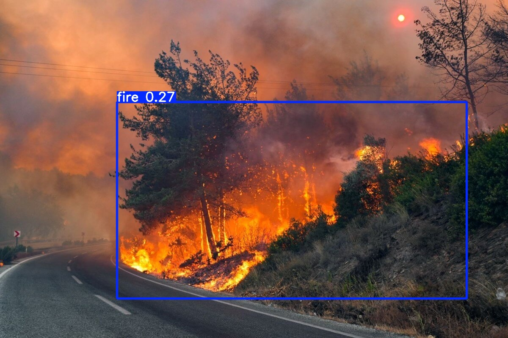
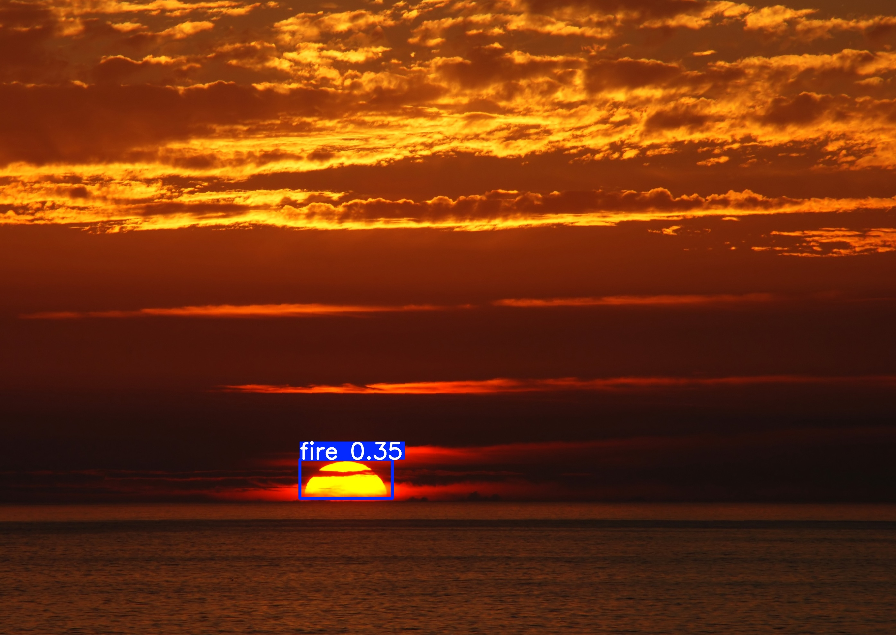
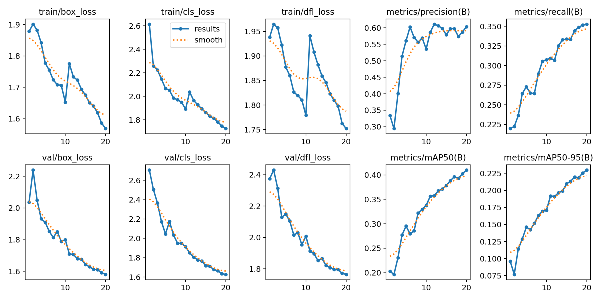
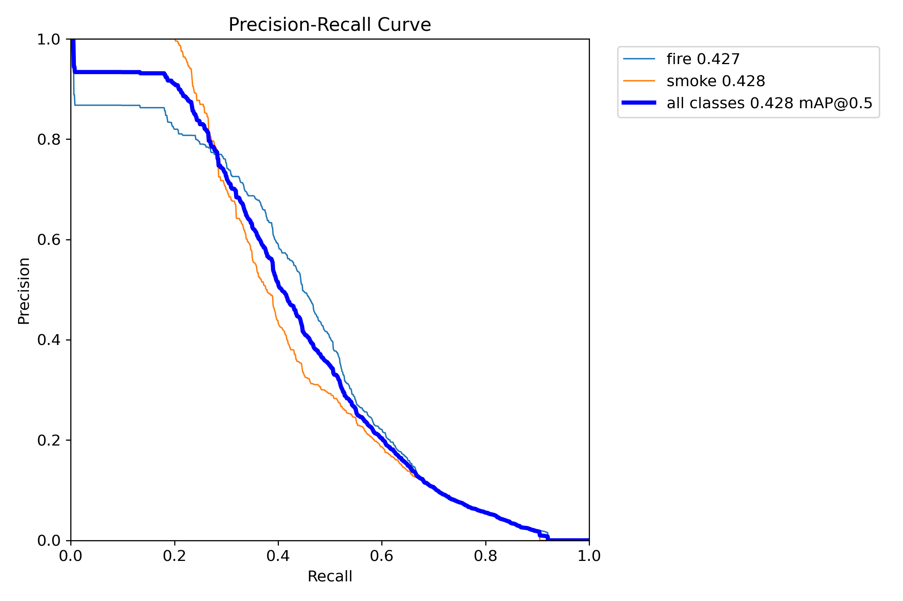
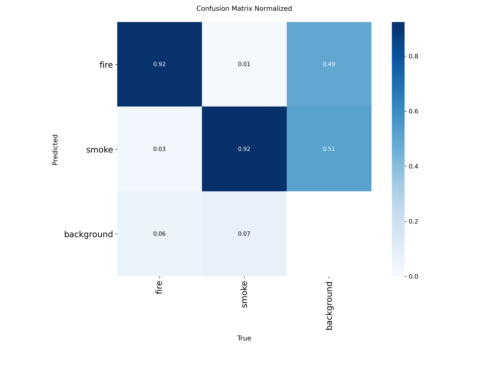

# Duman ve Yangın Tespiti – YOLOv8

Kamera görüntülerinde **yangın** ve **duman** tespit eden bir YOLOv8n modeli. Bu çalışmayı, SAYZEK Akademik Tez Programı'na başvurduğum *"Yangın ve Acil Durum Müdahalesinde Yapay Zekâ Destekli Prosedür Asistanı"* konusuna hazırlık olarak yaptım. Amacım ilk adım olan görsel tespit kısmını uçtan uca denemek, modelin nerede iyi çalışıp nerede zorlandığını görmekti.

## Sonuçlar

Test seti, modelin eğitim sırasında hiç görmediği görüntülerden oluşuyor.

| Küme | mAP@50 | mAP@50-95 | Precision | Recall |
|---|---|---|---|---|
| **Test** | **0,428** | 0,237 | 0,593 | 0,378 |
| Doğrulama | 0,410 | 0,230 | 0,590 | 0,355 |

Test setinde sınıf bazında sonuçlar:

| Sınıf | mAP@50 | Precision | Recall |
|---|---|---|---|
| fire | 0,427 | 0,509 | 0,447 |
| smoke | 0,428 | 0,678 | 0,309 |

- Görüntü başına çıkarım süresi Tesla T4'te yaklaşık **2,5 ms**.
- Karşılaştırma için: veri setinin Roboflow sayfasındaki hazır model mAP@50 = 0,447 bildiriyor. O modelin eğitim ayarları bilinmediği için bu birebir bir kıyas değil, sadece yaklaşık bir referans.

## Örnek tahminler

| Gerçek yangın | Yangın değil (gün batımı) |
|---|---|
|  |  |
| Yangın bulundu, güven **0,27**; yoğun duman işaretlenmedi | Güneş **yangın** sanıldı, güven **0,35** |

## Grafikler

| Eğitim eğrileri | Precision–Recall (test) | Karışıklık matrisi (test) |
|---|---|---|
|  |  |  |

## Gözlemler

1. **Recall düşük.** Model gördüğü yangınların ve özellikle dumanın önemli bir kısmını kaçırıyor; test setinde dumanda recall 0,31. Yangın tespitinde bir olayı kaçırmak, yanlış alarm vermekten daha tehlikeli olduğu için iyileştirilmesi gereken asıl nokta bu.
2. **Yanlış alarm, gerçek yangından daha yüksek güvenle çıkabiliyor.** Gün batımındaki güneş 0,35 güvenle yangın olarak işaretlendi, gerçek yangın ise sadece 0,27 aldı. Bu yüzden eşik değerini değiştirmek tek başına çözüm değil: eşiği 0,4'e çekmek yanlış alarmı kaldırıyor, ama gerçek yangını da kaçırıyor.
3. **Asistan tasarımına etkisi.** Tespit modeli bir dil modeli asistanına bağlandığında, düşük güvenli tespitler "kesin yangın" diye değil, "olası yangın, doğrulayın" diye iletilmeli.

## İyileştirme fikirleri

- Eğitim verisine yangın olmayan ama yangına benzeyen görüntüler (*hard negative*) eklemek: gün batımı, lamba, kırmızı ışık, şömine
- Daha uzun eğitim ve daha büyük modeller (YOLOv8s/m), ayrıca DETR tabanlı modellerle karşılaştırma
- Duman için ayrı veri artırma yöntemleri ve sınıf bazında eşik ayarı

## Eğitim ayarları

| | |
|---|---|
| Model | YOLOv8n (COCO ön eğitimli, ~3,0 M parametre) |
| Epoch | 20 |
| Görüntü boyutu | 640 |
| Batch | 16 |
| Optimizer | AdamW (otomatik, lr = 0,00167) |
| Donanım | Google Colab, Tesla T4 |
| Eğitim süresi | ~28 dk |

## Veri seti

[fire-n-smoke-detection](https://universe.roboflow.com/computer-vision-mkpxu/fire-n-smoke-detection-wuaqm/dataset/1) (Roboflow Universe, MIT lisansı), 9.008 görüntü, 2 sınıf (`fire`, `smoke`).

| Bölüm | Görüntü |
|---|---|
| Eğitim | 6.296 |
| Doğrulama | 1.809 |
| Test | 903 |

## Çalıştırma

1. `yolo_duman_yangin.ipynb` dosyasını Google Colab'da açın ve çalışma zamanı olarak T4 GPU seçin.
2. Roboflow'dan kendi API anahtarınızla veri setini YOLOv8 formatında indirin.
3. Hücreleri sırayla çalıştırın.

## Klasör yapısı

```
├── yolo_duman_yangin.ipynb   # Eğitim ve değerlendirme not defteri
├── images/                   # Örnek tahmin görselleri
├── results/                  # Eğitim eğrileri, test PR eğrisi ve karışıklık matrisi, results.csv
├── weights/best.pt           # Eğitilmiş model (YOLOv8n, 6,5 MB)
└── README.md
```

Eğitilmiş modeli kullanmak için:

```python
from ultralytics import YOLO
model = YOLO("weights/best.pt")
model.predict("resim.jpg", conf=0.25, save=True)
```

---
Serkan Osman Çakmak · Sakarya Üniversitesi Bilgisayar Mühendisliği
